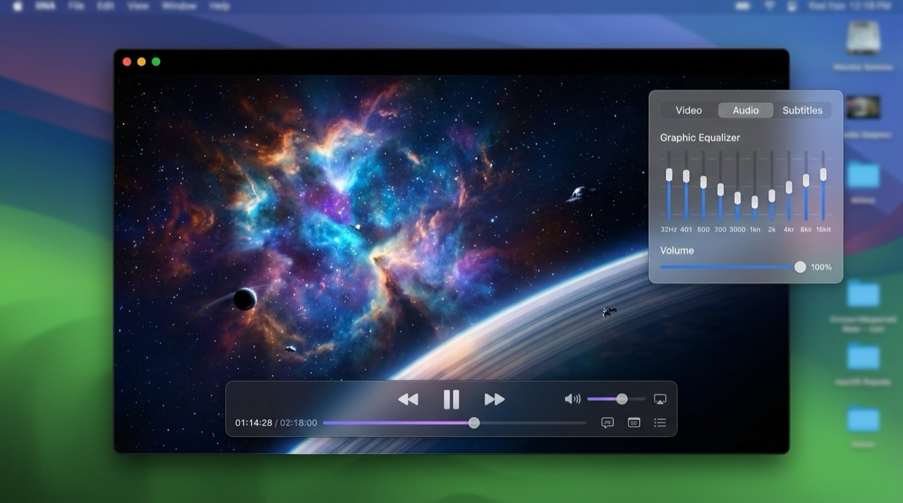

# IINA Media Player (MyPHP)

对标 macOS [IINA](https://iina.io) 的现代全功能原生音视频播放器，基于 [MyPHP](https://github.com/owner888/myphp) 构建。

A modern, hardware-accelerated media player modeled after IINA, built in pure PHP 8.4+ / 8.5 with [MyPHP](https://github.com/owner888/myphp).



## 特性 (Features)

- **硬件加速解码与 HDR**：支持 MKV、MP4、MOV、WebM、TS 及 HTTP/HLS 流媒体，10-bit HDR 与色调映射（Tone Mapping）、反交错（Deinterlace）。
- **Liquid Glass 现代界面**：悬浮毛玻璃控制栏（OSC）、缩略图进度预览、快速设置侧边栏（视频/音频/字幕调节、10 段均衡器、裁剪/旋转/画幅比）、播放列表与章节面板、音乐模式（Mini Player）。
- **libass 级 ASS/SSA 特效字幕**：完整支持自定义字体、描边、阴影、`\pos`、`\move`、`\t` 关键帧动画、`\k`/`\kf` 卡拉 OK 扫字、3D 透视旋转（`\frx`/`\fry`）与矢量绘图裁剪（`\p`/`\clip`），渲染于毛玻璃控制栏下方。
- **插件系统与插件商店**：内置在线字幕搜索（OpenSubtitles）、yt-dlp 在线视频解析与用户脚本插件，支持 GitHub 插件一键安装与 JS/PHP 开发者控制台。
- **桌面深度集成**：欢迎窗口、播放历史记录、画中画（Picture-in-Picture）、媒体键与系统 Now Playing 控制中心集成。

## 运行 (Run)

需要 PHP 8.4+（含 `ext-ffi`）与 `myphp` 框架检出（默认在 `../myphp`，可在 `myphp.json` 的 `framework` 字段配置）：

```sh
myphp run -d macos
# 或直接打开指定视频文件 / 流媒体地址：
myphp run -d macos /path/to/video.mkv
```

## 打包发布 (Build)

```sh
myphp build -d macos
```

## 测试 (Test)

```sh
php tests/run.php
```
